# ARES — Advanced Martian Exploration & Survival System
### NASA Space Apps Challenge 2026 • Interplanetary Survival Guide: Martian Map

[](https://nextjs.org/)
[](https://www.typescriptlang.org/)
[](https://openlayers.org/)
[](https://vercel.com/)
[](https://trek.nasa.gov/mars/)

---

## 1. Executive Summary & Challenge Solution

Human exploration of the Martian surface presents an unprecedented convergence of geospatial, physiological, and astrobiological hazards. Future astronauts conducting Extravehicular Activity (EVA) cannot rely on static visual maps: they require an integrated planetary information system capable of synthesizing multi-mission orbital altimetry, in-situ atmospheric telemetry, and terrain traversability models into explainable, Pareto-optimal mission flight plans.

**ARES (Advanced Martian Exploration & Survival System)** is a full-stack planetary GIS and mission-planning platform. Built on genuine data from **seven distinct NASA and USGS planetary science missions**, ARES transforms raw orbital observations into actionable astronaut survival intelligence.

### Key Capabilities
- **Planetary GIS Explorer:** High-performance equirectangular (Plate Carrée / EPSG:4326) Mars map powered by **OpenLayers**, integrating authentic NASA JPL Mars Trek WMTS tile services, layer opacity mixing, real-time coordinate crosshairs, and spatial distance measurement.
- **MOLA Numerical Terrain Intelligence:** Quantitative elevation querying relative to the Mars Areoid equipotential datum (Radius 3,396.0 km), computing 2.5D slope gradients ($\nabla z$) and surface roughness indexes down to single meters. Slopes are calculated strictly from numerical elevation grids—never from RGB imagery.
- **Science–Safety Route Optimizer:** Multi-objective A* pathfinding algorithm that navigates 2.5D Martian elevation cost grids to generate three distinct Pareto-optimal routes (*Safe Passage*, *Scientific Odyssey*, and *Balanced Expedition*), complete with NASA-STD-3001 metabolic energy and oxygen consumption modeling.
- **Mars Environmental Intelligence HUD:** In-situ atmospheric monitoring calibrated with NASA Mars 2020 Perseverance MEDA and MSL Curiosity REMS/RAD sensors, displaying diurnal thermal tides, dust optical depth ($\tau$), UV radiation flux, and galactic cosmic ray (GCR) dosimetric rates with rigorous scientific provenance.
- **NASA Science Explorer:** Live querying of the official NASA Image and Video Library (`images-api.nasa.gov`) and planetary science archives with multi-rover filtering and sample return target dossiers.
- **Mission Briefing Generator:** Exportable astronaut EVA flight plans in GeoJSON format and downloadable mission dossiers.

---

## 2. Integrated NASA & USGS Datasets

ARES maintains transparent data provenance for every layer and measurement. Observations, calibrated archives, and general circulation climate models are strictly distinguished:

| Dataset | Mission / Instrument | Processing Level & Product ID | Spatial Resolution | Coordinate Reference System (CRS) | Official Source |
| :--- | :--- | :--- | :--- | :--- | :--- |
| **MOLA MEGDR** | Mars Global Surveyor (NASA/GSFC) • Laser Altimeter | PDS Level 4 (`MEGDR128_TOPOGRAPHY_V1`) | 128 pix/deg (~463 m/pix) | IAU 2000 Mars Areoid Datum (0m = 3396.0 km) | [PDS Geosciences](https://pds-geosciences.wustl.edu/missions/mgs/mola.html) |
| **THEMIS IR Day** | 2001 Mars Odyssey (NASA/ASU) • Thermal Emission | Level 5 (`ODY-M-THM-5-DDR-V1.0`) | 100 meters/pixel | Simple Cylindrical Mars Equator | [ASU THEMIS](https://themis.asu.edu/maps) |
| **Viking MDIM 2.1** | Viking Orbiters 1 & 2 (NASA/USGS) • VIS | PDS Level 5 Controlled Mosaic | 232 meters/pixel | Mars IAU/IAG 2000 System | [USGS Astrogeology](https://astrogeology.usgs.gov/search/map/Mars/Viking/MDIM21) |
| **USGS Geologic Map** | Tanaka et al. (2014) USGS Multi-Mission Synthesis | Scientific Investigations Map 3292 | Vector Polygons / 1:20M Scale | Equirectangular Mars Sphere | [USGS SIM 3292](https://pubs.usgs.gov/sim/3292/) |
| **MEDA In-Situ** | Mars 2020 Perseverance (NASA/JPL) • MEDA ATS/PS/RDS | CODMAC Level 3/4 Physical Units | In-Situ (18.4447°N, 77.4508°E) | Local Rover Surface Frame | [PDS Atmospheres](https://pds-atmospheres.nmsu.edu/) |
| **RAD Dosimetry** | MSL Curiosity (NASA/JPL/SwRI) • RAD Silicon Detector | Derived Dosimetric Quantities | In-Situ (-4.59°S, 137.44°E) | Surface Track Frame | [PDS Atmospheres](https://pds-atmospheres.nmsu.edu/) |
| **SHARAD Radar** | Mars Reconnaissance Orbiter (NASA/ASI) • Sounding Radar | PDS Level 5 Migrated Radargrams | ~15m vertical in ice | Orbital Nadir Tracks | [PDS Geosciences](https://pds-geosciences.wustl.edu/missions/mro/sharad.htm) |
| **NASA Image API** | NASA Image & Video Library (NASA HQ) | Public RESTful Open API | Multi-spectral native | N/A (Orbital & Ground-Truth) | [images-api.nasa.gov](https://images-api.nasa.gov) |

---

## 3. Core Innovation: Science–Safety Route Optimizer

ARES's primary technical differentiator is its **explainable multi-objective route-ranking engine**.

### Mathematical Formulation
The traversal corridor between an EVA Departure Point $S$ and Mission Objective $D$ is discretized into a 2.5D topographic grid. The cost of transitioning between nodes $u \rightarrow v$ is defined by:

$$C(u, v) = \Delta d \cdot \Big[ w_{\text{safe}} \cdot \Phi_{\text{hazard}}(\theta, \rho) + w_{\text{eff}} \cdot \Phi_{\text{resource}}(\Delta t, \dot{V}_{O_2}) - w_{\text{sci}} \cdot \Psi_{\text{science}}(v) + w_{\text{conf}} \cdot \Omega_{\text{uncertainty}} \Big]$$

Where:
- $\Delta d$ is the Great-Circle distance computed using the spherical Haversine formula calibrated for Mars volumetric mean radius ($R_{Mars} = 3,389.5\text{ km}$).
- $\theta = \arctan(|\nabla z|) \cdot \frac{180}{\pi}$ is the numerical slope angle derived from MOLA elevation differences.
- $\Phi_{\text{hazard}}(\theta, \rho)$ applies steep exponential penalties for slopes exceeding $8^\circ$, severe penalties above $15^\circ$, and marks terrain exceeding $25^\circ$ (the dynamic stability limit of pressurized EVA spacesuits) as impassable.
- $\Phi_{\text{resource}}$ models astronaut physiological strain based on **NASA-STD-3001** standards:
  $$\dot{V}_{O_2} = \text{RMR} \cdot \left(1 + \beta \cdot \max(0, \theta - 5^\circ)\right) \cdot (1 + 0.25 \rho)$$
- $\Psi_{\text{science}}$ rewards detours through high-priority geological contacts, clay/carbonate outcrops, and prime biosignature candidates.
- $\Omega_{\text{uncertainty}}$ penalizes unverified or low-resolution terrain, guaranteeing that unknown terrain is never classified as safe.

### Three Strategic Traverses
1. **Safe Passage:** Prioritizes minimal slope exposure ($<8^\circ$), avoiding crater scarps, boulder fields, and rover wheel-entrapment zones.
2. **Scientific Odyssey:** Detours through high-priority astrobiological sample locations, maximising scientific return for Mars Sample Return missions.
3. **Balanced Expedition:** Achieves optimal equilibrium between astronaut life-support margins, manageable terrain slopes, and high scientific sample yield.

---

## 4. Technical Architecture

ARES is engineered exclusively for cloud deployment on **Vercel's serverless infrastructure** with a GitHub-native continuous deployment pipeline:

```mermaid
flowchart TD
    subgraph Client ["Client Browser (Desktop / Tablet / Mobile)"]
        UI["ARES Modern Aerospace HUD"]
        Globe["HTML5 Canvas 3D Mars Globe"]
        OLMap["OpenLayers 10 Planetary GIS Map"]
        Charts["Recharts Elevation & Diurnal Curves"]
    end

    subgraph Serverless ["Vercel Serverless Edge API Routes"]
        ApiTerrain["/api/terrain/elevation & /profile"]
        ApiRoutes["/api/route/optimize"]
        ApiEnv["/api/environmental"]
        ApiNasa["/api/nasa/images"]
        ApiReports["/api/reports/generate"]
        ApiDatasets["/api/datasets"]
    end

    subgraph DataSources ["Authoritative External Data Sources"]
        Trek["NASA JPL Mars Trek WMTS Services"]
        NasaImg["NASA Image & Video Library API"]
        MolaData["NASA MOLA Areoid Datum Model"]
        UsgsData["USGS Astrogeology SIM 3292"]
        MedaData["NASA Mars 2020 MEDA & Curiosity REMS/RAD"]
    end

    UI --> OLMap
    UI --> Globe
    UI --> Charts
    OLMap <--> ApiTerrain
    UI <--> ApiRoutes
    UI <--> ApiEnv
    UI <--> ApiNasa
    UI <--> ApiReports
    Serverless <--> DataSources
```



### Stack Components
- **Framework:** Next.js 14 (App Router)
- **Language:** TypeScript 5.7 (Strict Type Safety)
- **Planetary Cartography:** OpenLayers 10 (EPSG:4326 Equirectangular Projection)
- **Scientific Visualization:** Recharts (Area & Line Charts)
- **Styling:** Tailwind CSS (Dark Aerospace Mission-Control Theme)
- **Icons:** Lucide React
- **Validation:** Zod Schema Enforcement

---

## 5. GitHub & Vercel Deployment Instructions

ARES is designed to deploy seamlessly from GitHub to Vercel without requiring any persistent server daemons or local runtime configurations.

### 1. Push to GitHub
Commit all project source files to your GitHub repository:
```bash
git add .
git commit -m "feat: complete ARES Martian exploration and survival system"
git push origin main
```

### 2. Connect to Vercel
1. Log in to [Vercel](https://vercel.com).
2. Click **Add New...** -> **Project**.
3. Select your GitHub repository (`martian-survival-guide`).
4. In the configuration screen:
   - **Framework Preset:** Next.js
   - **Root Directory:** `./`
   - **Build Command:** `npm run build` (or Next.js default)
   - **Output Directory:** `.next`
5. Environment Variables (Optional):
   - `NASA_API_KEY`: Set your official NASA API key (defaults to demo key if omitted).
6. Click **Deploy**.

Vercel will automatically build the static assets, optimize serverless API functions, and assign a production HTTPS URL. Every subsequent push to `main` triggers an automatic preview and production deployment.

---

## 6. Verification & Quality Assurance

ARES includes a complete automated test suite (`scripts/test-suite.ts`) verifying all underlying mathematical, geospatial, and routing functions:
- Great-Circle Haversine distance calculations on Mars.
- MOLA Areoid elevation datum integrity and numerical slope calculations.
- Science-Safety Route Optimizer Pareto-ranking and scoring.
- NASA-STD-3001 metabolic cost and oxygen consumption scaling.
- Environmental telemetry limits and MEDA/REMS/RAD data provenance.
- Complete metadata registry for all 8 NASA/USGS datasets.

### Automated Test Results:
```text
======================================================
 ARES MARTIAN EXPLORATION SYSTEM — AUTOMATED QA SUITE
======================================================
--- 1. Planetary Distance & Coordinate Math ---
  ✓ PASS: Haversine distance for 0.055° lat on Mars (~3.28 km)

--- 2. MOLA Altimetry & Slope Calculations ---
  ✓ PASS: Jezero crater basin elevation within MOLA datum range (-2560m)
  ✓ PASS: Gale Crater Mt Sharp mound elevated relative to crater floor (-4450m)
  ✓ PASS: Slope calculation produces valid degrees (0-90°)
  ✓ PASS: Jezero central landing area is traversable
  ✓ PASS: High data confidence for MOLA coverage

--- 3. Science-Safety Route Optimizer Engine ---
  ✓ PASS: Generates 3 Pareto-optimal routes (Balanced, Safe, Scientific)
  ✓ PASS: All three strategy types present
  ✓ PASS: Safe route has higher safety score than balanced route
  ✓ PASS: Scientific route has higher science score than safe route
  ✓ PASS: Overall score in valid range 0-100
  ✓ PASS: Oxygen consumption adheres to NASA EVA limits

--- 4. NASA-STD-3001 EVA Metabolic Cost Modeling ---
  ✓ PASS: Steep slope (16°) increases oxygen consumption over flat terrain
  ✓ PASS: Steep slope and high roughness reduce traverse speed

--- 5. Environmental & MEDA/RAD Telemetry ---
  ✓ PASS: Diurnal temperature within authentic Martian bounds
  ✓ PASS: Atmospheric pressure reflects Jezero elevation column
  ✓ PASS: Surface GCR radiation matches Curiosity RAD measurements (~0.64 mGy/day)
  ✓ PASS: Distinguishes genuine in-situ rover observations

--- 6. Scientific POIs & Datasets Metadata ---
  ✓ PASS: Rich scientific catalog with 10+ authentic NASA targets
  ✓ PASS: Water ice POI has clear extraction feasibility and SHARAD radar provenance
  ✓ PASS: All 8 required NASA and USGS datasets registered with full provenance
  ✓ PASS: MOLA dataset correctly references Mars Areoid datum

======================================================
 TEST SUMMARY: 22 PASSED | 0 FAILED
======================================================
```

---

## 7. Ethical AI & NASA Compliance Disclosure

- **Authenticity:** All planetary measurements, coordinates, elevations, and imagery originate from peer-reviewed NASA and USGS publications. No scientific discoveries, instrument readings, or terrain features have been fabricated.
- **AI Tooling Disclosure:** This application was architected, written, and verified using Google Antigravity AI engineering agents in strict compliance with the NASA Space Apps Challenge 2026 rules.
- **No Logo Modifications:** Official NASA and USGS logos, emblems, and insignia are not modified or embedded in AI-generated imagery. All mission credits adhere to NASA JPL Media Usage Guidelines.

---

*ARES — Engineered for the explorers of the red planet.*
